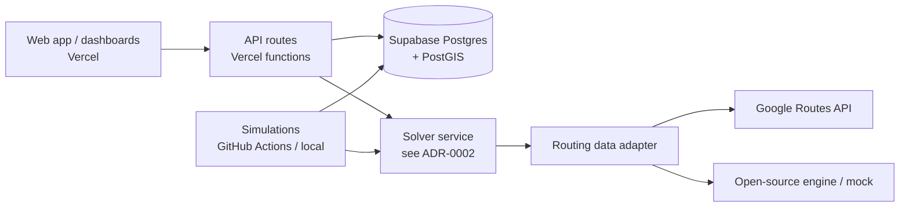

# Architecture Overview (v0)

Owner: architect · Status: DRAFT seeded by orchestrator · Card: PH-002

## Core domain entities (to be refined in PH-002)
- **Node** — fixed location (hub, depot, locker) with opening hours, capacity.
- **Vehicle** — capacity, shift, start/end node, cost profile.
- **Packet** — origin, destination, size/weight, time windows, priority.
- **Route** — ordered stops for one vehicle in a plan.
- **Leg** — movement between two consecutive stops (distance, duration, ETA source).
- **Hop** — a packet changing custody: node→vehicle, vehicle→node, or vehicle→vehicle (in-flight).
- **Scenario / Plan** — inputs + solver output for comparison and simulation.

## Principles
- Provider-agnostic routing adapter (Google, open-source, recorded fixtures).
- Problem/solution exchanged as versioned JSON contracts.
- All geodata in PostGIS types; all timestamps UTC.
