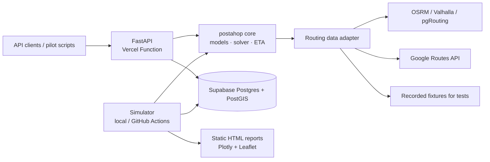

# Architecture Overview (v1)

Owner: architect · Status: DRAFT seeded by orchestrator · Issue: PH-002, PH-014

## Core domain entities (to be refined in PH-002)
- **Node** — fixed location, capacity (hundreds of packets), opening hours, handling + queue time.
- **Vehicle** — capacity (limited), shift, start/end node, cost profile.
- **Packet** — origin, destination, size, time windows, priority.
- **Route** — ordered stops for one vehicle in a plan.
- **Leg** — travel between consecutive stops (distance, duration, ETA source).
- **Hop** — custody change at a stopped point: vehicle→node, node→vehicle, vehicle→vehicle.
- **Rendezvous** — location + time window where two vehicles meet for a hop.
- **Event** — delay, breakdown, new order; triggers rerouting.
- **Scenario / Plan / Run** — inputs, solver output, simulation execution with KPIs.

## Principles
- One Python package (`postahop`) shared by API, simulator and reports.
- Provider-agnostic routing adapter; tests never hit paid APIs.
- Versioned Pydantic contracts for scenario/plan/events.
- Geodata in PostGIS types; timestamps UTC.
